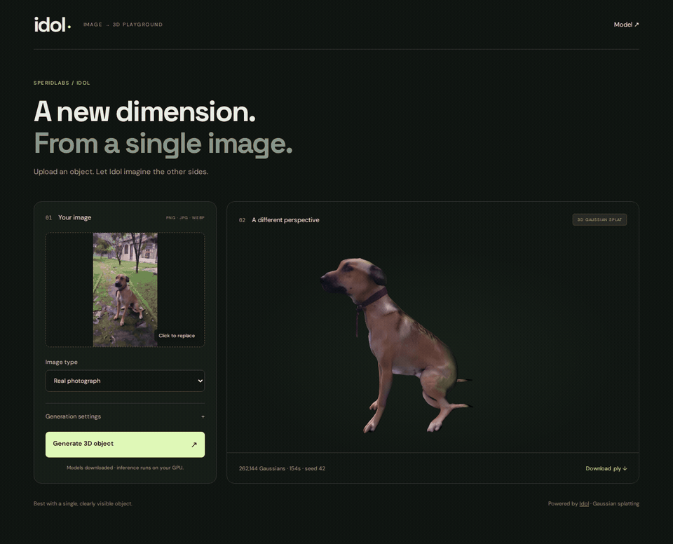

# Idol Playground

A local image-to-3D web app: generate a Gaussian splat (`.ply`) with [Idol](https://huggingface.co/speridlabs/idol), or a textured polygon mesh (`.glb`) with [TripoSR](https://github.com/VAST-AI-Research/TripoSR). Preview the result in your browser and download it.

## See it in action

Paçoca, reconstructed from a single photograph and rotated in the local app.

[](docs/demos/pacoca-turntable.mp4?raw=1)

[Download the MP4](docs/demos/pacoca-turntable.mp4?raw=1) · [Demo details](docs/demos/README.md)

## Run locally

Requires Python 3.11–3.13, [uv](https://docs.astral.sh/uv/), Node.js 20.19+ (or 22.12+), and an NVIDIA CUDA GPU. The model card reports approximately 7.2 GB peak VRAM at default settings. This machine's RTX 3060 has 12 GB; other GPU applications also consume VRAM.

```bash
git clone https://github.com/andrepaim/idol-playground.git
cd idol-playground
uv sync --locked --extra local
npm ci
npm run build
```

Download the model files and start the app. No Hugging Face account or login is required:

```bash
uv run --no-sync python model_setup.py
./run.sh
```

Open **http://127.0.0.1:8000**. If you skip the explicit download command, the first generation downloads the missing files automatically. Once downloaded, the app loads all model components from local directories.

Weights and encoders total about 5 GB. Model loading takes longer than subsequent requests. Idol stays in memory between splat requests and unloads before mesh generation. Requests run one at a time. CUDA must be available to PyTorch; the app does not fall back to slow CPU inference. This uses the upstream SDK pinned to commit `8db700349a5570aac390e4780fa32e3eed6b587a`.

## Textured meshes

Add the mesh backend to an existing installation:

```sh
make setup-mesh mesh-models
npm run build
./run.sh
```

Choose **Textured mesh · .glb** after uploading a photo. Set a triangle budget and texture size, then inspect the result with orbit, wireframe, and reset controls. The GLB embeds its texture. Mesh jobs report progress/ETA and can be cancelled.

The mesh backend has its own pinned Python/CUDA environment. Starting it releases cached Idol tensors, and the worker exits after each job. Meshes are currently unrigged prototypes; inspect anatomy before animation. See [mesh setup, settings, limitations and validation](docs/mesh-generation.md), including a mesh-only setup path.

## Idol model sources

`model_setup.py` pins and downloads only the necessary files into the ignored `models/` directory:

| Component | Public source | Pinned revision |
| --- | --- | --- |
| Idol + background remover | [speridlabs/idol](https://huggingface.co/speridlabs/idol) | `2731c2291fc65a797c5cb627a5e5526fc1490902` |
| DINOv3 ViT-H+/16 | [LibreYOLO/LibreDINOv3vith16plus](https://huggingface.co/LibreYOLO/LibreDINOv3vith16plus) | `e849a3492905c6dabc89758042bf1402770fb4e6` |
| FLUX.2 VAE only | [black-forest-labs/FLUX.2-klein-4B](https://huggingface.co/black-forest-labs/FLUX.2-klein-4B) | `e7b7dc27f91deacad38e78976d1f2b499d76a294` |

The DINOv3 source is a community mirror of Meta's encoder, stored in bfloat16, the precision Idol uses. Its publisher reports identical bfloat16 tensors and outputs to the upstream checkpoint; that equivalence has not been independently compared against the gated original here. The original DINOv3 license and attribution are retained in `models/dinov3/LICENSE` and `NOTICE`. Expected mirror weight SHA-256: `34252ee11eeebf00d50c528d53d725672f03ad88ff30cb724ddf3920bf67dc4c`.

The VAE comes from Black Forest Labs' public Apache-2.0 Klein release. The [Idol SDK documents](https://github.com/speridlabs/idol-sdk#python-api) using a compatible FLUX.2 autoencoder from Klein through `image_encoders`. This downloads the VAE, not the full Klein image-generation model. Model cards and available license files are kept with each download.

## Usage and files

- Use **Real photograph** for photos, or **Render / AI-generated image** for synthetic inputs. A single object works best.
- The default is 50 steps, 262,144 Gaussians, guidance 3, time shift 3, and seed 42. For a quicker first test, try 10 steps and 65,536 Gaussians.
- Generation reports loading, background removal, image analysis, live sampling steps, Gaussian decoding, saving, and preview preparation. The ETA starts as a rough estimate and updates using completed GPU steps; successful runs calibrate stage estimates in `outputs/.timings.json`. Download time and browser preview time do not have a GPU-based ETA.
- Drag the preview to orbit, use the wheel to zoom, and right-drag to pan. Preview requires WebGL2; a PLY download remains available if preview fails.
- Uploads accept PNG, JPEG, or WebP, up to 20 MB / 25 megapixels. EXIF orientation is corrected and oversized inputs are scaled to a maximum side of 2048 pixels before inference.
- Inputs and results are saved in `outputs/<job-id>/`. Delete folders there to reclaim space when the app is idle. Completed job metadata is saved in `job.json` so its status can be read after a restart. An interrupted generation cannot be resumed.
- Binding to `127.0.0.1` keeps the app local. It has no accounts and is intended for personal use.

Optimization with `torch.compile` is off by default to avoid a long compilation on the first trial and reduce GPU memory pressure. Set `IDOL_OPTIMIZE=1 ./run.sh` to enable the SDK's optimized sampling path.

## Development and checks

```bash
make bootstrap
make check
make doctor
```

Bootstrap uses a separate `.venv-check` with CPU PyTorch and installs Chromium. The CUDA environment stays in `.venv`. Tests do not download model weights. CI checks code, frontend build, real Chromium acceptance with synthetic data, documentation, and committed-history security.

See [getting started](docs/getting-started.md), [development](docs/development.md), [validation](docs/validation.md), and the [documentation index](docs/README.md). Follow [AGENTS.md](AGENTS.md) for issue ownership, planning, TDD, worktrees, risk-based checks, PR integration, and release authorization. The [mesh stage](docs/mesh-generation.md) is implemented; the broader [Game Character roadmap](docs/game-character-plan.md) includes subsequent rigging and animation work.

The tests cover upload validation, concurrent request rejection, generation failures, downloadable artifacts, public-model setup, saved job status, adaptive ETA timing, and guided/unguided sampling step counts. CPU substitutes do not validate model quality. Real-GPU validation is deliberate and uses the [hardware protocol](docs/validation.md#real-gpu-protocol).

An additional real GPU check succeeded on this machine's RTX 3060: the official backpack example, synthetic mode, 10 steps, seed 42, and 262,144 Gaussians. With progress tracking, total request time including initial model loading was 38.6 seconds. All 10 sampling steps and all six server stages were recorded; ETA updates were observed through completion. The PLY was byte-identical to the baseline generated before progress instrumentation. The DINOv3 weight file's SHA-256 was independently checked against the mirror publisher's value above.

For experimental skeleton prediction, skinning and GLB/FBX/Blender exports after mesh inspection, see [automatic rigging](docs/automatic-rigging.md). Install with `make setup-rig rig-models`.

An optional [splat-derived mesh experiment](docs/splat-mesh-results.md) tests preserving the existing Idol result using rendered stereo views and surface fusion. It is separate from the current TripoSR mesh option.
