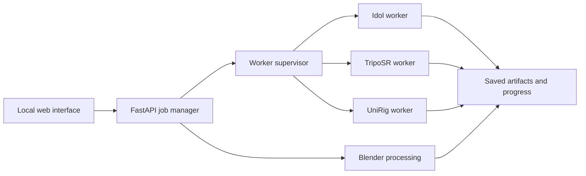

# Game Character generation plan

Status: experimental MVP implemented. PR #17 adds textured mesh generation; PR #18 adds local skeleton prediction, skinning, diagnostic bend preview and GLB/FBX/Blender exports. Geometry-quality refinement, engine import/retargeting and authored animations remain future work. See [mesh generation](mesh-generation.md), [automatic rigging](automatic-rigging.md) and [actual validation](rig-validation.md).

The current UI exposes **Textured mesh** followed by **Auto rig · experimental**. This roadmap retains the broader **Game Character** target: useful character geometry and validated assets for a selected game engine.

The implemented baseline is **TripoSR → mesh cleanup/UV baking → UniRig → Blender export and validation**. Actual tests prove sequential local execution on the NVIDIA RTX 3060 with 12 GB VRAM. Broader geometry/deformation quality acceptance remains open; individual models running successfully does not establish game-ready characters.

This plan assumes engine-neutral exports until a target engine is selected. All inference runs locally.

## 1. First-release scope

Target full-body humanoids and quadrupeds, including Paçoca as a challenging real-photo case. Favor separated limbs and clear body poses; A/T poses are suitable humanoid starting points.

| Output | Purpose |
|---|---|
| Textured mesh | Inspect or use as a static asset |
| Rigged `.glb` | Mesh, textures, skeleton, and skinning in one file |
| Rigged `.fbx` with textures | Alternative for engine and animation workflows |
| Editable `.blend` | Correct geometry, bones, or weights in Blender |
| Validation report | Explain detected problems and export properties |
| Diagnostic animation | Show whether joints bend plausibly |

Describe the result as a **rigged character prototype**. Automatic reconstruction and rigging can still require corrections around shoulders, hips, hands, clothing, and hidden surfaces.

Playable controls and production-quality walk/run animations are separate work from generating the asset.

## 2. Technical feasibility gate

Before building the interface, run a small experiment using three suitable character images and one known-good humanoid mesh.

The known-good mesh isolates rigging problems from reconstruction problems. For each image, run the complete sequence through textured mesh generation, processing, skeleton generation, skinning, and export.

Measure:

- Peak GPU memory and system RAM for every stage.
- Cold-start and warm-start duration.
- Triangle count, texture quality, and preservation of separate limbs.
- Skeleton placement and joint deformation.
- Whether exported textures and skinning survive reimport.

TripoSR documents approximately 6 GB VRAM for default inference. UniRig's model card requests more than 8 GB. Those figures make sequential execution plausible on a 12 GB GPU, but do not prove that every mesh and setting will fit. See the [TripoSR documentation](https://github.com/VAST-AI-Research/TripoSR) and [UniRig model card](https://huggingface.co/VAST-AI/UniRig).

**Acceptance gate:** at least one generated character must complete the pipeline, retain its textures, and bend plausibly at major joints. If reconstruction consistently merges the limbs, revisit the mesh generator before expanding the UI.

## 3. Reproducible model environments

Use independent environments for the existing Idol backend, TripoSR, and UniRig.

The published dependencies differ: TripoSR pins Transformers 4.35.0, while UniRig pins 4.51.3 and includes Blender's Python module, Flash Attention, and additional compiled dependencies. See the [TripoSR requirements](https://raw.githubusercontent.com/VAST-AI-Research/TripoSR/main/requirements.txt) and [UniRig requirements](https://raw.githubusercontent.com/VAST-AI-Research/UniRig/main/requirements.txt).

The setup workflow will:

- Pin source commits, model revisions, and a tested PyTorch/CUDA combination for each environment.
- Download the required reconstruction, skeleton, skinning, and background-removal weights.
- Capture any additional encoder downloads performed by upstream code.
- Preserve model cards and license files.
- Verify required files before reporting readiness.
- Support interrupted download recovery.
- Run a small inference check after installation.

Expose readiness independently for **3D Splat** and **Game Character**.

After setup, run an offline smoke test to verify that inference no longer needs network access. No training datasets are required.

## 4. GPU memory and worker processes

The current app keeps Idol in the server process. During planning, the GPU had roughly 6.8 GB in use with Idol loaded, leaving insufficient space for the proposed rigging stages.

Introduce a worker supervisor with exclusive ownership of GPU execution:



Only one GPU worker runs at a time. An idle Idol worker may stay loaded for repeated splat jobs, but it must exit before character generation begins. TripoSR and the UniRig stages release GPU memory when their processes finish.

Initially retain the existing one-job-at-a-time behavior. A second request receives a clear busy response.

The supervisor captures structured progress, logs, exit codes, and process heartbeats. Cancellation terminates the relevant process group and preserves completed intermediate artifacts.

## 5. Image-to-mesh generation

Add a TripoSR adapter that accepts the validated image and produces a textured source mesh.

1. Respect existing transparency or remove the background.
2. Frame the complete character without cropping hands or feet.
3. Reconstruct geometry.
4. Extract the mesh.
5. Bake appearance into a texture.
6. Assemble and validate the material.

TripoSR provides texture baking, extraction resolution, and chunk-size controls. Smaller chunks offer a documented way to reduce memory use. Its current baking script writes geometry and a separate texture image, so the adapter must explicitly verify their material connection. See the [TripoSR inference implementation](https://raw.githubusercontent.com/VAST-AI-Research/TripoSR/main/run.py).

Preserve the original reconstruction before subsequent processing. This provides a comparison and allows processing retries without regenerating the image.

## 6. Geometry preparation and appearance preservation

Use Blender automation to produce the mesh that will actually be rigged.

Processing includes removing degenerate geometry, checking normals, establishing consistent scale and orientation, and reducing triangle count toward a selected budget.

Initial proposed presets:

| Setting | Preview | Standard |
|---|---:|---:|
| Target triangles | 10,000 | 25,000 |
| Texture size | 1,024 px | 2,048 px |
| Purpose | Faster iteration | Better prototype quality |

These are product defaults to benchmark, not guarantees of visual quality or runtime performance.

If processing changes the UV layout, rebake appearance from the source mesh. Preserve disconnected pieces unless there is strong evidence that they are reconstruction debris; clothing and accessories may legitimately be separate.

**Freeze geometry before skinning.** Changing vertex layout afterward can invalidate weights or require an explicit transfer step.

Automatic simplification reduces complexity but does not guarantee good deformation topology. The report should flag obvious geometry problems and retain the source mesh for comparison.

## 7. Skeleton generation and skinning

Run UniRig's skeleton prediction followed by skinning prediction. Merge the **skinned result** with the textured mesh.

UniRig explicitly states that merging its skeleton-only output does not provide skinning. Its documentation also warns that inaccurate skeletons degrade the skinning result. See the [UniRig workflow](https://github.com/VAST-AI-Research/UniRig).

Validation checks:

- A valid, acyclic bone hierarchy.
- Finite transforms and valid joint references.
- Nonnegative, normalized vertex weights.
- Unweighted vertices.
- A usable relationship between the skeleton and mesh.
- Plausible major humanoid joints where they can be identified.

For the initial export profile, limit weights to four influences per vertex, renormalize, and inspect the resulting deformation.

Keep humanoid bone mapping separate from skeleton prediction. A generated skeleton does not automatically match a game engine's humanoid naming or rest-pose conventions.

If rigging fails, the user should still be able to download the textured mesh and retry rigging without repeating reconstruction.

## 8. Character interface and preview

Add a mode selector near image upload:

| Mode | Main result |
|---|---|
| 3D Splat | Existing Idol `.ply` |
| Game Character | Textured and rigged mesh |

Character mode shows brief input guidance: one complete character, visible limbs, an uncluttered background, and preferably an A-pose or T-pose.

Start with a small settings panel: quality preset, target height, and advanced triangle/texture controls. Expose a skeleton seed only where the backend supports it.

The result viewer supports:

- Textured, solid, and wireframe views.
- Skeleton overlay.
- Orbit, zoom, and reset camera.
- Triangle, bone, and texture statistics.
- Bind-pose reset.
- A slow joint-bending diagnostic.
- Download buttons for each completed artifact.

Use Three.js's mesh-loading and animation facilities alongside the existing splat viewer. Dispose of the previous viewer when switching modes to avoid accumulating browser GPU memory.

If humanoid joint identification is uncertain, offer individual bone inspection rather than applying a misleading automatic humanoid pose.

## 9. Progress messages and ETA

Reuse the existing progress presentation, with character-specific stages:

```text
Prepare image → Generate mesh → Bake appearance → Optimize mesh
→ Generate skeleton → Calculate weights → Validate → Export → Open preview
```

Messages describe actual work, for example:

> Calculating how the mesh follows each bone…

> Mesh complete. Generating the skeleton…

> Checking textures and skinning in the exported file…

Maintain separate timing histories by backend, stage, quality settings, and cold/warm start.

Use measured work counts where the backend exposes them. For opaque stages, display an indeterminate indicator and a history-based estimate. On the first run, show **Estimating…** until there is a defensible basis.

Display elapsed time, approximate remaining time, completed stages, and a collapsible log. An overrun changes the message instead of leaving the timer at zero.

Model download progress remains separate from generation ETA.

## 10. Durable jobs and recovery

Extend the job model:

| Field | Meaning |
|---|---|
| `pipeline` | Idol or character generation |
| `state` | Running, complete, partial, failed, cancelled, interrupted |
| `stage` | Current operation |
| `progress` | Actual work count where available |
| `eta_seconds`, `eta_basis` | Estimate and its basis |
| `artifacts` | Files with type and purpose |
| `warnings` | Geometry, rig, or export concerns |
| `provenance` | Model revisions and effective settings |

Persist job metadata atomically after each completed stage. Record stage inputs and settings so a retry can reuse compatible artifacts.

After a server restart, unfinished jobs become **interrupted**. Resuming starts from the last valid checkpoint rather than claiming to restore an in-memory model operation.

Keep the existing Idol API working. Add dedicated character creation, cancellation, and retry operations, using the common job-status endpoint.

Invoke workers with argument arrays and generated workspace paths. User filenames must never become shell commands.

## 11. Export packaging and verification

Proposed download bundle:

```text
character/
  character.glb
  character.fbx
  character.blend
  textures/
    base_color.png
  validation.json
  generation.json
  import-notes.txt
```

Use GLB as the primary browser-preview artifact. FBX includes separate textures where needed.

Record the chosen height, coordinate conversion, model versions, and effective settings. Preserve the generated appearance without inventing unsupported metallic or roughness detail.

Reimport each supported export into a fresh validation process. Check textures, transforms, skeletons, weights, and diagnostic animation after the round trip.

Include a simple engine import test before release. Once an engine is selected, add a matching import recipe and sample scene. Demonstrate export validity and engine compatibility separately.

## 12. Animation milestone

The first release includes a diagnostic bend animation to evaluate the rig.

The next milestone adds useful motion:

1. Choose a small, redistributable humanoid animation set.
2. Map generated bones to the animation skeleton.
3. Correct rest-pose and scale differences.
4. Retarget idle and walk clips.
5. Inspect foot sliding, joint twisting, and root motion.
6. Export baked clips with the character.

Automatic mapping needs a manual correction path when confidence is low. A compact bone-mapping panel is sufficient initially; a full browser rig editor would be a much larger feature.

Facial animation, detailed finger rigs, cloth simulation, and automatic character controllers can follow once body generation and retargeting work reliably.

## 13. Implementation responsibilities

| Area | Planned change |
|---|---|
| `app.py` | Route requests and expose backend readiness |
| `jobs.py` | Persist jobs, artifacts, cancellation, and retry state |
| `workers.py` | Supervise processes and exclusive GPU ownership |
| `pipelines/idol.py` | Wrap existing Idol inference |
| `pipelines/character.py` | Coordinate character stages |
| `adapters/` | Integrate pinned TripoSR and UniRig versions |
| `blender/` | Process meshes, validate rigs, and export |
| `model_setup.py` | Manage separate backend manifests |
| `progress.py` | Support stage definitions and timing profiles |
| `web/` | Add mode controls, mesh viewer, and artifact downloads |
| `tests/` | Cover orchestration, exports, and browser behavior |

Keep model-specific dependencies inside their worker environments so the web server remains lightweight.

## 14. Implementation order and acceptance checks

| Milestone | Completion criteria |
|---|---|
| A. Feasibility | One complete generated character works on the actual GPU |
| B. Reproducible setup | Pinned environments install and pass offline inference checks |
| C. Mesh mode | Upload produces a textured, processed mesh with preview |
| D. Rigging | Skeleton, weights, diagnostic posing, and downloads work |
| E. Reliability | Cancellation, partial results, retries, restart recovery, and ETA work |
| F. Engine validation | Export imports and animates in the selected engine |
| G. Motion support | Idle/walk retargeting works with a correction path |

Automated checks cover orchestration failures, stage reuse, malformed worker responses, invalid weights, missing textures, and GPU ownership. Browser tests cover mode switching, progress, repeated previews, cancellation, and partial-result downloads.

The real-GPU acceptance run includes several suitable characters, one difficult input, cancellation, recovery from a failed stage, and **Idol → character → Idol** switching.

Defer a firm delivery estimate until milestone A. The largest uncertainties are compiled dependency compatibility and the quality of reconstructed anatomy.
