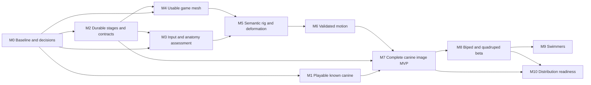

# Image to playable character: milestones and dependencies

Status: adopted roadmap, 2026-11-11; see [implementation progress](playable-progress.md). See the [architecture and scope](image-to-playable-plan.md) and [validation contract](image-to-playable-validation.md). Milestone completion below means implementation accepted and merged with required evidence; none is marked complete by writing this plan.

## 1. Sequence and critical path

M1 proves interaction early with a known asset. M2 provides durable contracts without waiting for model-quality research. M3/M4 experiments can be explored after M0, but their production integration depends on M2. M5 combines reviewed anatomy and prepared meshes; M6 cannot compensate for a structurally unusable rig. M7 joins the paths into the first honest image-to-playable experience. M8 expands supported anatomy; M9 is optional and is not a prerequisite for a land-character release.

Suggested execution order for one session: M0, M1, M2, M3, M4, M5, M6, M7, then M8. Perform the M4 reconstruction feasibility spike early if M0 finds severe anatomy failures. This document does not authorize parallel agents. If separate sessions later work concurrently, coordinate GPU and app-port ownership and use distinct worktrees. CPU/runtime work can proceed while a GPU-dependent increment is blocked, provided it has independent acceptance criteria.

## 2. Milestone and effort overview

Sizing is relative engineering effort, not a calendar promise: S is a focused increment; M spans several related increments; L includes substantial integration or uncertain quality research. Split L milestones before implementation. Hardware availability, corpus preparation, correction UI and reconstruction quality dominate scheduling uncertainty. Establish calendar estimates after M0 and revise after M4/M5 feasibility results.

| Milestone | Size / uncertainty | User-visible exit | Hard dependencies |
|---|---|---|---|
| M0 | M / medium | Frozen scope, corpus and measured baseline | Planning approval for implementation, available test assets/hardware |
| M1 | M / low-medium | Known canine is controllable in a Three.js test scene | M0, reviewed redistributable or local-only canine fixture |
| M2 | L / medium | Stage results survive reload/restart and retry safely | M0, storage/API design |
| M3 | M / medium | User can review/correct anatomy before reconstruction/rigging | M2 for integration; provider optional |
| M4 | L / high | Prepared game mesh meets anatomy, appearance and budget gates | M2, corpus and reconstruction experiment |
| M5 | L / high | Validated semantic rig with supported corrections | M3, M4, GPU availability |
| M6 | L / high | Reviewed natural canine idle/walk with stable deformation | M5, licensed/authored motion source |
| M7 | L / medium | Upload to playable canine and portable export | M1, M2, M3, M4, M5, M6 |
| M8 | L / high | Measured biped and canine-like quadruped coverage | M7, per-family rigs and motion |
| M9 | L / high | Validated swimmer family and depth controls | M8, swimmer corpus and controller design |
| M10 | M / medium | Reproducible distributable candidate and documented support | M7 for canine candidate, M8 for land beta; M9 only if swimmers included |

## 3. Detailed work packages

Each numbered package should become an independently reviewable issue/PR when authorized. If a package still contains multiple independently shippable behaviors, split it further. Record owner, dependency links, acceptance, checks and evidence location before coding. Use disabled capability flags for incomplete integration; never expose an unsupported family as ready.

### M0 — Baseline, scope and decision freeze

**Purpose:** turn assumptions into measurable constraints and identify the actual bottleneck before committing to broad anatomy support.

1. **M0.1 Repository/issue audit:** compare current code and evidence with open issues; document shipped portions and remaining acceptance. Confirm model revisions/environments and current API behavior. Avoid duplicate tickets.
2. **M0.2 Corpus and rights:** assemble the development/held-out/adversarial assets in the validation plan, with licenses, provenance, hashes and expected body plans. Keep private inputs local. Separate authored runtime fixtures from generated quality evidence.
3. **M0.3 Baseline measurements:** run the current image→GS→mesh→rig→canine-motion path where supported; record per-stage failures, wall time, host RAM, GPU use, disk use, mesh sizes and visual findings. Include unsupported cases as explicit results rather than forced completions.
4. **M0.4 Decisions:** freeze T0/T1 capability, axes/scale convention, runtime/browser target, quantitative budgets, manual-correction limit and evaluation procedure. Decide whether the M4 feasibility spike must precede more integration.

**Entry:** authorized milestone, exclusive scheduled GPU access, intact working environments and approved asset provenance.

**Exit:** baseline report tied to a revision and effective settings; all cases accounted for; decision log states which thresholds are hard, provisional or deferred. No broad success claim based on one dog. Record a prioritized implementation backlog, not an automatic authorization of every issue.

**Validation:** artifact/license review, current API compatibility probes, actual RTX 3060 inference for selected supported baselines, independent visual review where available. Missing GPU evidence blocks model feasibility conclusions but does not block schema/runtime design.

### M1 — Playable scene from a known canine

**Purpose:** demonstrate “playable” quickly, isolating gameplay problems from reconstruction quality.

1. **M1.1 Runtime contract and fixture:** define the minimal GLB/manifest loader; establish units, axes, scale, clip names and movement mode. Use a reviewed existing canine output privately or a licensed fixture publicly. Add malformed/unsupported manifest tests first.
2. **M1.2 Controller:** implement deterministic input normalization, acceleration, heading, fixed-step movement, ground/wall collision and reset. Test diagonal speed, frame-rate independence, wall sliding/blocking and focus loss before implementation.
3. **M1.3 Animation and camera:** add idle/standing hold ↔ walk transitions, bounded playback speed, follow/orbit camera and clear controls. Disable unavailable run/jump behavior rather than substituting misleading animations.
4. **M1.4 Lifecycle and sample:** verify character replacement, pause/resume, scene cleanup and a minimal downloadable sample. Isolate the reusable runtime from authoring UI.

**Entry:** M0 frozen runtime contract and known asset. No new model inference required unless the fixture itself must be generated.

**Exit:** T0 browser scenarios pass; character moves/turns/stops/collides predictably, camera remains usable, no root-motion doubling, sample launches from a clean local HTTP environment. Report static hold as a prototype limitation.

**Validation:** unit tests for control/collision logic; browser keyboard/camera/animation tests; actual hardware WebGL performance receipt. Software-rendered CI is functional evidence only. No inference/GPU claim is needed for pure runtime changes.

**Failure response:** reduce scene complexity or revise controller contract if budgets/collision fail. Do not weaken reconstruction gates because a known rig works.

### M2 — Durable character jobs and versioned artifacts

**Purpose:** support long multistage work without corrupting useful results or losing progress on reload/restart.

1. **M2.1 Schema and compatibility:** implement versioned character/stage manifests, safe artifact references, hashes and compatibility readers. Preserve current endpoints/defaults and old completed outputs. Tests cover missing/unknown versions and corrupt records.
2. **M2.2 Stage publication:** implement attempt directories, output validation, atomic publication and dependency fingerprints. Test partial writes, insufficient disk space, failed exports, stale hashes and interrupted publication using disposable fixtures.
3. **M2.3 Ownership/recovery:** reconcile startup state, process identity and GPU ownership; explicitly reject a conflicting server. Cancel/reap children before releasing ownership. Add restart/retry/idempotency tests and actual worker/GPU lifecycle acceptance when integration changes.
4. **M2.4 Review and retry API:** support review pauses, corrections, selective downstream invalidation and retry from verified boundaries. Add status/UI reconnection; keep original artifacts accessible.

**Entry:** M0 contracts/ownership decisions; no active owner-data mutation for tests.

**Exit:** reload does not duplicate jobs; restart identifies interrupted work; valid outputs remain usable; retry does not rerun unchanged expensive stages; changed inputs invalidate all affected descendants; cancelled/failed workers leave no conflicting GPU owner. Old completed jobs remain viewable/downloadable.

**Validation:** state-machine and API tests, isolated filesystem fault injection, worker process-tree tests, browser reconnect, real GPU cancellation/retry if model lifecycle changes. A mock worker proves coordinator logic, not CUDA cleanup. No automatic deletion/migration of existing outputs.

**Failure response:** leave the integration disabled and unmerged if required storage/lifecycle acceptance fails; retain legacy paths and document the blocker.

### M3 — Input preparation and anatomy assessment

**Purpose:** route characters by supported body plan and expose uncertainty before expensive or inappropriate processing.

1. **M3.1 Deterministic/manual route:** implement input suitability checks, crop/isolation review, manual body-plan selection, orientation/scale fields and explicit unsupported outcomes.
2. **M3.2 Structured reasoning adapter:** define request/response schema and provider interface; implement a fake provider for tests and no-provider fallback. Do not enable external calls until provider/cost/data-transfer decisions are settled.
3. **M3.3 Evaluated reasoning:** compare proposals on development images and canonical mesh renders against annotations. Validate references, reject invalid output, enforce budgets and stop retry loops. Test image text that tries to instruct the system, timeout, malformed output and contradictory views.
4. **M3.4 Review integration:** display evidence and uncertainty, accept user corrections, persist the selected profile, and invalidate only dependent stages. Route anthropomorphic animals by anatomy.

**Entry:** M2 for integration; optional real provider credentials/authorization for provider evaluation only.

**Exit:** every input gets a supported profile, a review request, or an actionable rejection. Manual mode completes without network calls. Unsupported types never fall through to canine motion. AI-assisted accuracy, review rate, latency and cost are measured against the fallback.

**Validation:** schema/API/UI tests, annotated development and held-out routing evaluation, correction lineage, secret-free exported manifests. Provider unavailability does not block the local/manual workflow.

### M4 — Reconstruction quality and game mesh preparation

**Purpose:** establish whether generated anatomy can survive animation and browser budgets.

1. **M4.1 Anatomy experiment:** score current reconstruction by body/style cell. Inspect limb separation, missing geometry, visible identity and back-side uncertainty. Time-box alternative reconstruction experiments if the baseline cannot meet the target; use identical inputs and report all trials.
2. **M4.2 Preparation primitives:** implement transform normalization, component diagnostics, mesh validity reports and immutable derivatives. Add synthetic bad-mesh regression fixtures before implementation.
3. **M4.3 Simplification/appearance:** evaluate multiple triangle budgets; preserve vertex colors or implement validated UV/baking where required. Compare silhouettes, joint regions and colors against the dense source. Record when retopology/manual repair is necessary.
4. **M4.4 Stage and UI:** integrate reports, before/after previews and retry settings. Prevent rigging an anatomy-blocked mesh unless a clearly labeled experiment is requested; experimental output cannot receive accepted status.

**Entry:** M0 corpus; M2 integration; isolated artifacts; actual reconstruction GPU availability.

**Exit:** supported canine development cases meet mesh gates and include a demonstrated successful held-out candidate. Prepared meshes meet agreed runtime budgets with retained appearance and sufficient anatomy for M5. The report distinguishes reconstruction failures from preparation regressions.

**Validation:** geometry/transform/color unit fixtures, actual image/GS reconstruction on the RTX 3060 for changed inference paths, Blender/GLB inspection, browser appearance, visual multi-view review and downstream deformation probes once M5 exists. Final M7 acceptance rechecks the combined path.

**Failure response:** issue a documented go/no-go for the reconstruction route. Narrow the supported input envelope, investigate a backend or add a scoped correction workflow. Do not present decimation or skeleton prediction as a repair for absent limbs.

### M5 — Semantic rigging and deformation

**Purpose:** transform arbitrary predicted joints into a reliable supported articulation contract.

1. **M5.1 Profile schema:** define required/optional roles, chain constraints, rest-pose conventions and expected contacts. Implement graph/symmetry/geometry checks on authored valid and invalid rigs.
2. **M5.2 Mapping adapter:** map UniRig output to semantic roles; combine deterministic constraints with optional structured proposals. Preserve raw predictions and mapping confidence/evidence.
3. **M5.3 Review/correction:** add skeleton overlay, joint picking, left/right/fore/hind reassignment and profile correction. Document what cannot be corrected without rebuilding the skeleton; do not imply arbitrary bone editing is supported.
4. **M5.4 Skin and probes:** validate weights, bind matrices, deformation ranges, contact-region attachment and export/reimport. Compare skin transfer when the prepared mesh differs from the inference mesh.

**Entry:** M3 reviewed anatomy and M4 viable meshes; pinned UniRig/Blender environments; exclusive GPU slot.

**Exit:** required joints are mapped, missing or ambiguous roles block motion, supported corrections are reproducible, deformation probes pass, appearance survives GLB/FBX/Blender export. The known canine path retains its existing behavior.

**Validation:** skeleton and weight tests; malformed hierarchy/semantic mapping regressions; real GPU skeleton and skin inference at the new revision; visual deformation clips; three-format reimport. Include at least one held-out canine and adversarial asymmetric/occluded cases.

**Failure response:** preserve static mesh/rig artifacts and identify the failed anatomical region. A new rigger or learned model modification needs a separate experiment and hardware/license gate.

### M6 — Canine motion quality and runtime clip contract

**Purpose:** produce a believable supported motion set, not just joint movement.

1. **M6.1 Motion source:** audit current procedural canine motion and independent references; establish redistribution rights for any external clips. Freeze expected gait, stance and joint constraints.
2. **M6.2 Retarget/procedural profile:** use semantic roles and proportions, preserve reference/rest transforms, generate reviewed idle and walk, and keep in-place/forward modes explicit.
3. **M6.3 Contact and deformation:** measure stance sliding, penetration, loop seams and speed matching. Inspect rear-leg anatomy, cross-limb weights and torso/tail motion; fix the actual mesh/rig stage when motion tuning cannot resolve the cause.
4. **M6.4 Transition contract:** export named clips and metadata; validate idle↔walk and speed changes in the M1 runtime. Keep experimental trot/run disabled until independently accepted.

**Entry:** M5 validated rigs, motion provenance, runtime clip contract from M1.

**Exit:** T1 natural idle/walk passes numerical and visual gates on supported cases, including a held-out candidate. Contact metrics and manual appearance review agree that the result is usable; known remaining limits are visible.

**Validation:** gait/contact math tests, deformation/export round trips, actual affected worker execution, multi-angle motion review, browser transition tests and real GPU checks whenever skinning/model execution changes. Blender-only motion changes require actual Blender acceptance; they do not automatically require new CUDA inference unless that path is affected.

**Failure response:** stop the case at rig/motion review. A low contact error with visibly broken legs is a failure, not a completed natural-walking issue.

### M7 — End-to-end canine image MVP

**Purpose:** connect accepted stages into the product's first complete user journey.

1. **M7.1 Coordinator and UI:** connect upload, assessment, splat, mesh, rig, motion, package and play. Surface stage-specific retry/review; preserve existing splat/mesh-only workflows.
2. **M7.2 Packaging:** produce sanitized GLB/manifest/source sample, license/provenance inventory and launch instructions; pin template dependencies and prevent private paths/inputs/credentials from leaking.
3. **M7.3 Acceptance:** run the frozen canine corpus from fresh uploads through real inference, motion, browser play and exported sample. Include reload/restart, cancelled job, failed stage and correction/retry journeys in disposable state.
4. **M7.4 Support documentation:** document suitable images, supported anatomy, correction limits, typical measured duration/resource ranges and how to recover from each common failure.

**Entry:** M1–M6 acceptance and integrated current-main revision.

**Exit:** T1 gates in the validation plan pass; successful cases play and export; failures are recoverable and honestly labeled. The sample works without the authoring backend. Required CI and actual GPU/browser receipts identify the same accepted code/settings or explicitly document unaffected paths.

**Validation:** full local/API/browser integration, RTX 3060 end-to-end inference, hardware-rendered runtime budgets, clean sample install/build/run, original features regression and export privacy scan. A smoke test alone does not establish the corpus success rate.

### M8 — Biped and broader quadruped land beta

**Purpose:** expand coverage without hard-coding the first dog's topology.

1. **M8.1 Biped anatomy and rig:** add semantic roles/rest-pose normalization, human/humanoid evaluation and review; support animal-headed humanoids by body plan.
2. **M8.2 Biped motion:** add licensed/authored idle/walk/run retargeting, proportion checks, contact correction and runtime state transitions. Facial/finger animation remains outside scope.
3. **M8.3 Quadruped generalization:** replace fixed joint-count assumptions with validated profile contracts, test different proportions/styles, and add trot with distinct gait acceptance. Do not automatically include horses, insects or all mammals.
4. **M8.4 Matrix and beta acceptance:** run all land corpus cells, compare against M7 canine regression results, document supported subfamilies and exclusions, and update readiness/UI/profile selection.

**Entry:** M7 complete; body-specific corpus and motion assets available.

**Exit:** T2 quantitative/visual gates pass across supported land cells. Report success and manual-review rates by family and style; one successful biped does not validate humanoids broadly. Existing canine behavior and exports remain accepted.

**Validation:** per-family unit/semantic fixtures, actual GPU mesh/rig trials, retarget and contact checks, browser speed/state/collider behavior and clean exports for both families.

### M9 — Swimmer expansion

**Purpose:** support a substantially different body plan and locomotion system.

1. **M9.1 Feasibility:** reconstruct and rig fish/shark-like subjects; assess axial chain, tail and optional fins. Freeze the specific supported anatomy before building broad UI claims.
2. **M9.2 Motion:** implement or retarget axial/tail swim cycles and turn response with continuous body deformation. Swimming uses different quality metrics from ground contact.
3. **M9.3 Controller:** add depth controls, speed/turn limits, bounded water volume, appropriate collider and camera. Avoid applying gravity/stance constraints from land profiles.
4. **M9.4 Acceptance:** run swimmer corpus and land regressions; package a swimmer-capable sample and document unsupported fins/anatomies.

**Entry:** M8 architecture stable; swimmer corpus and motion strategy; GPU and runtime test access.

**Exit:** T3 gates pass, including tail/body continuity and stable ascent/descent. Unsupported swimmer anatomy is rejected or held for review.

**Validation:** axial-motion and controller tests, real inference, multi-angle visual review, browser volume collision and transitions, exports and land-family regressions.

### M10 — Distribution readiness, separate from publication

**Purpose:** make the selected tier reproducible and supportable before any release request.

1. **M10.1 Clean setup:** verify pinned environments/readiness, cache reuse, documented disk/model requirements, offline behavior after setup where supported, and useful missing-model/provider errors.
2. **M10.2 Candidate audit:** review accumulated changes, compatibility, export licenses, dependency/security checks, supported hardware and unresolved limitations. Revalidate affected behavior after current-main integration.
3. **M10.3 Evidence and handoff:** record revision, corpus results, GPU/browser environments, package checksums, support instructions, known failures and rollback/recovery instructions.
4. **M10.4 Publication gate:** only an explicit release request starts the [release checklist](releases.md), version/tag changes, distribution or deployment. M10 itself produces a candidate and report, not a release.

**Exit:** the chosen tier has complete required evidence, reproducible setup and no unresolved acceptance blockers. Optional later families may remain disabled and clearly outside the support claim.

## 4. Existing issue reconciliation

Snapshot: seven open issues on 2026-11-11, no open PRs when planning began. Labels and status can change; refresh before selecting work. This table proposes reconciliation, not issue closure or authorization.

| Existing issue | Current relation | Proposed treatment |
|---|---|---|
| [#2 — local character pipeline](https://github.com/andrepaim/idol-playground/issues/2) | TripoSR title predates preferred splat-mesh route; broader quality feasibility remains | M0 audit, M4/M5/M7 evidence; clarify backend scope before completion |
| [#3 — model setup and GPU workers](https://github.com/andrepaim/idol-playground/issues/3) | Significant setup/exclusivity foundation exists | Audit remaining criteria; link M2/M10 additions instead of reimplementing shipped code |
| [#4 — textured mesh and Blender](https://github.com/andrepaim/idol-playground/issues/4) | Mesh routes exist; game topology/appearance preparation needs evaluation | Map remaining work to M4, preserving both vertex-colored and textured assets |
| [#6 — interface/viewer/recoverable jobs](https://github.com/andrepaim/idol-playground/issues/6) | Viewer exists; durable stage recovery is incomplete | Separate M2 recovery and M7 staged interface acceptance |
| [#7 — selected engine import](https://github.com/andrepaim/idol-playground/issues/7) | User now proposes Three.js as first playable target | Propose Three.js acceptance in M1/M7; confirm original broader engine criteria before closure |
| [#8 — humanoid mapping/motion](https://github.com/andrepaim/idol-playground/issues/8) | Future biped capability | M8 depends on M5 semantic contracts and usable humanoid meshes |
| [#26 — natural dog walking](https://github.com/andrepaim/idol-playground/issues/26) | Experimental motion/app integration exists; anatomy/natural-quality limits remain | M5/M6 close the actual quality gaps; keep parent open until all criteria pass |

Proposed additional issue groups, to create only when implementation scope is authorized: baseline corpus; runtime/controls; character schema; atomic stage storage; recovery/ownership; anatomy review; optional reasoning; mesh preparation benchmark; semantic mapping/correction; portable sample packaging; end-to-end canine acceptance; swimmer feasibility. Split by the numbered packages above, attach dependency links and avoid duplicate parents.

## 5. Execution, review and stopping rules

For each authorized increment:

1. Refresh `origin/main`, priorities, dependencies and ownership. Choose one ready issue and claim it; keep one active issue per session.
2. Write the concrete behavior/acceptance/risk/validation plan. Create an isolated short-lived branch/worktree.
3. Write meaningful failing tests for testable behavior, implement, and refactor with checks passing. For exploratory/visual work, record the limited automated coverage and concrete visual acceptance procedure.
4. Run relevant automated checks, API/browser acceptance and required real-GPU checks. Store sanitized evidence with revision/settings and clear limitations.
5. Review the diff and evidence, integrate current main, rerun affected combined checks, merge via PR, and verify combined-commit CI. Do not call a pushed branch “done.”
6. Refresh the queue. A missing dependency, unavailable GPU or unresolved product decision blocks its dependent work; record the blocker/next action and continue independently authorized ready work.

Model-quality experiments may end with a documented negative result and revised recommendation; they must not be relabeled successful feature delivery. No deadline or pressure to close issues waives required acceptance. No roadmap item authorizes paid calls, destructive owner-data tests, public deployment, releases or work in another session's workspace.
