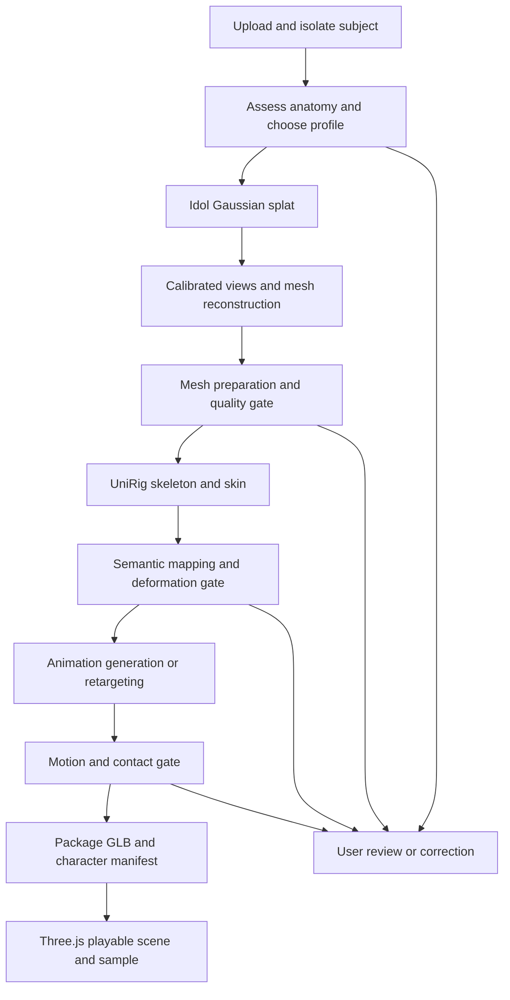

# Image to playable character: implementation plan

Status: **proposal; no implementation authorized by this document**. Prepared 2026-11-11 against `origin/main` at `49793c405283133295ee200c8e0a788d14454055` on `docs/image-to-playable-plan`.

This plan turns a photo, drawing, or rendered image of a person, animal, or person-like character into a controllable character in a Three.js scene. It extends the existing local app. It does not promise a correct reconstruction of every subject from one image: unseen anatomy is inferred, and some inputs must be corrected or rejected.

Read this document for product behavior and architecture, [milestones](image-to-playable-milestones.md) for implementation order and dependencies, and [validation](image-to-playable-validation.md) for acceptance and evidence. The older [Game Character plan](game-character-plan.md) and [natural walking plan](natural-walking-plan.md) remain historical context. This proposal adds the broader playable-character direction; it does not claim their outstanding criteria are complete.

## 1. Product outcome and scope

A successful user journey is:

1. Upload one PNG, JPEG, or WebP containing one main character.
2. Inspect the isolated subject and proposed body plan; correct orientation, body type, and physical scale when needed.
3. Generate a Gaussian splat and inspect it from multiple views.
4. Generate and prepare a mesh while preserving the original splat and high-resolution mesh.
5. Fit a skeleton and skin weights, review semantic joints and a deformation preview, and correct supported ambiguities.
6. Generate or retarget appropriate motion, then inspect contact, deformation, and transitions.
7. Press **Play** to control the character in a small browser scene.
8. Download the animated GLB and a runnable Three.js sample with metadata, dependency lockfile, and instructions.

Each stage shows its result, validation status, cost/time information where available, and actionable failures. A rejected rig must not acquire a misleading “playable” badge merely because a GLB file exists. Users can keep useful earlier artifacts and retry downstream work.

### Delivery tiers

| Tier | Supported promise | Explicit limits |
|---|---|---|
| T0: gameplay proof | Existing reviewed canine output loads, moves, turns, collides, and switches idle/walk in Three.js | Uses a known asset; proves no new image reconstruction quality |
| T1: canine image MVP | Supported full-body canine inputs complete the staged image-to-play flow with review and bounded corrections | Experimental quality; no claim of arbitrary quadruped support |
| T2: land-character beta | Validated humanoid/biped and canine-like quadruped families across photo, drawing, and rendered inputs | Each family has a capability profile and measured coverage; no “all animals” claim |
| T3: swimmer expansion | Fish/shark-like body plans with swim, turn, ascend, descend, and water-volume control | Separate motion/controller family; no implied walking or automatic arbitrary anatomy |

Scope includes local authoring, a single controllable character, a simple test environment, reusable runtime code, and portable assets. Facial animation, dialogue, multiplayer, combat, clothing simulation, fingers, wings, tentacles, production game levels, mobile performance guarantees, and public hosting are separate future work. The source may accept stylized characters, but acceptance depends on supported anatomy and motion, not on a species label alone.

## 2. What exists and what remains

The baseline is grounded in [architecture](architecture.md), [mesh generation](mesh-generation.md), [automatic rigging](automatic-rigging.md), and [canine walking](canine-walking.md). Documentation of a successful experiment is evidence for its tested subject/settings, not general product acceptance.

| Capability | Existing foundation | Remaining work |
|---|---|---|
| Image to splat | Local Idol inference, saved PLY and prepared image, browser preview | Input suitability assessment, lineage into character stages, broader corpus |
| Splat to mesh | Calibrated capture, DLNR stereo, fusion, vertex-colored GLB; saved-splat entry point | Anatomy checks, game topology, simplification, appearance preservation at runtime budgets |
| Alternative reconstruction | Legacy TripoSR textured mesh path | Controlled comparison only if preferred route fails; no silent backend switch |
| Rigging | Pinned UniRig skeleton and skin inference, GLB/FBX/Blender export | Semantic mapping, anatomy-aware checks, profile routing, correction workflow |
| Motion | Experimental reviewed canine hierarchy, paw review and limited swaps, in-place/forward walking | Generalized profiles, natural-quality gates, humanoid motion, transitions and speed matching |
| Viewer | Mesh/skeleton/animation preview and turntable capture | Player input, collision, camera, animation state machine, standalone sample |
| Jobs | Exclusive generation ownership, subprocess phases, cancellation, persisted terminal metadata | Durable stage commits, restart recovery, dependency invalidation, retries, structured review pauses |
| AI reasoning | No general character reasoning service assumed | Optional bounded vision/reasoning adapter, evidence, schema validation and manual fallback |

Dense reconstructed meshes can exceed 600,000 triangles. Simplifying them does not repair fused legs or recover missing anatomy. Existing canine contact measurements do not establish natural gait or broad rig quality. The first technical uncertainty is whether reconstruction provides usable anatomy for the intended families; the second is whether rigging and motion preserve that anatomy under movement.

## 3. Recommended pipeline

Review loops resume from the earliest affected stage. They do not rerun every successful stage. Keep the Gaussian splat as a visual reference and intermediate artifact; the initial playable representation is a conventional skinned mesh. Deformable splat gameplay is separate research with a different renderer/deformation contract.

### 3.1 Input assessment and preparation

- Validate decoded dimensions, byte limits, image type, alpha handling, and a single intended subject. Reject malformed or oversized inputs with a clear reason.
- Show cropping/background isolation before costly inference. Reuse existing preprocessing where suitable; evaluate an additional segmentation model only if the corpus demonstrates a need.
- Record view direction, visibility of limbs, occlusion, contact with other objects, crop completeness, and whether the pose is likely to reconstruct reliably. A side-view dog may hide an entire pair of legs; apparent limb count is not the anatomical ground truth.
- Recommend a full-body, unobstructed image. Offer replacement/crop corrections for unsuitable inputs rather than inventing missing features without disclosure.
- Estimate **body plan** (`biped`, `quadruped`, `swimmer`, `unsupported`, `uncertain`), optional species hypothesis, expected limb chains, locomotion family, symmetry assumptions, and confidence/evidence. A dog-headed humanoid should route to biped motion.
- Allow manual profile selection. Store user overrides separately from model proposals, with revision and provenance. Physical scale comes from a user setting or an explicit default, never an asserted measurement from a single image.

Input approval means “worth attempting,” not “guaranteed to rig.” Reassess anatomy using the reconstructed mesh and canonical renders before rigging.

### 3.2 Gaussian splat and reconstruction

- Retain Idol as the baseline, preserving source image, prepared image, PLY, settings, seed where supported, model revisions, and stage timings.
- Retain calibrated captures and the current DLNR/fusion route. Record camera conventions and color-space handling; preserve the saved-splat conversion entry point.
- Compare multiple views against the original silhouette and visible appearance. Mark back-side appearance as inferred. Do not treat plausible novel views as independent evidence of truth.
- Evaluate reconstruction at fixed baseline settings before tuning. If missing/fused limbs dominate failures, run a bounded reconstruction experiment before expanding the rigging system.
- Any alternate image-to-mesh method must compete on the same development corpus, hardware, runtime budget, licenses, and downstream deformation tests. It must produce the same mesh-stage contract. Keep backend selection visible and preserve API defaults.

### 3.3 Mesh preparation

Preparation produces a separate game mesh and a report, never overwriting the reconstruction.

1. Normalize transforms, units, forward axis, handedness, and floor/reference origin. Record the transform and its inverse.
2. Remove clearly spurious components using configurable, reviewed rules. Preserve meaningful detached accessories unless the chosen export profile cannot handle them.
3. Diagnose holes, self-intersections, non-manifold regions, degenerate faces, disconnected anatomy, fused limbs, and insufficient joint-region geometry. Some are warnings; missing required limb chains are blockers.
4. Compare simplification strategies against silhouette, color, joint deformation and contact. Use decimation as a candidate, not proof of animation topology. Introduce retopology or a guided correction path when decimation fails.
5. Preserve vertex colors for the initial route where quality/budget allow. If texture baking is needed, explicitly introduce UV unwrapping, bake validation, seam checks, and material/color-space tests. Do not silently drop appearance to meet triangle targets.
6. Produce runtime bounds, a simple collision proxy, optional later LODs, and a static GLB. The collider is a gameplay approximation, separate from the detailed visual mesh.

Prototype rigging can still use a dense source where necessary, but the packaged character must pass runtime budgets. Weight transfer between different topologies requires its own deformation validation. A mesh that looks acceptable while static can still fail joint bending.

### 3.4 Skeleton, semantic mapping and skinning

[UniRig](https://github.com/VAST-AI-Research/UniRig) documents separate skeleton and skinning stages and remains the existing integration baseline. This plan does not assume its current local interface accepts a species-conditioned prompt. Anatomy reasoning initially chooses profiles and validates/maps output; changing the model's conditioning or training is a separate experiment.

- Predict the skeleton, then map generated joints to semantic roles using mesh geometry, connectivity, symmetry, canonical views, and optional vision proposals.
- Required roles are profile-specific: pelvis/spine/head and limb chains for bipeds; torso/head and fore/hind limb chains for quadrupeds; axial chain/tail and supported fins for swimmers. Optional anatomy stays optional.
- Validate hierarchy, left/right consistency, plausible chain lengths, joint locations relative to the mesh, and reachable contact points. Generic bone names alone are not enough.
- Review uncertain mappings with a visible skeleton overlay and selectable joints. Begin with semantic reassignment and profile corrections. Arbitrary skeleton editing/rebuilding is an explicit later work package, not an implicit MVP promise.
- Run skinning and deterministic deformation probes. Inspect shoulders/hips, knees/elbows, paws/feet, tail base, and silhouette under motion. Measure weight normalization and cross-limb leakage.
- Preserve original inference and corrected derivatives. A skeleton/topology correction invalidates skinning, motion and package outputs. A semantic-only reassignment invalidates dependent motion and validation without necessarily rerunning the model.
- Keep existing GLB, FBX and Blender exports supported. Additional format validation is necessary whenever shared export behavior changes.

The initial strategy uses existing UniRig plus constrained correction. Alternative riggers enter only if measured failures justify a benchmark, their assets/licenses are usable, and they fit the owner's hardware.

### 3.5 Motion production

Rigging and animation are separate stages. A skeleton supplies articulation; it does not supply a plausible gait.

| Family | Initial required clips | Later clips | Key checks |
|---|---|---|---|
| Reviewed canine | Idle/standing hold and walk | Trot/run, richer idle, turn clips | Paw identity, stance/contact, rear-leg anatomy, loop continuity |
| Generalized canine-like quadruped | Idle, walk, trot | Species-specific variants | Proportions, gait phase, foot sliding, tail behavior |
| Humanoid/biped | Idle, walk, run | Turn, jump, interactions | Rest-pose alignment, semantic retargeting, foot contact, proportions |
| Swimmer | Swim and turning response | Speed variants, richer fin motion | Axial wave, tail amplitude, body continuity, depth control |

A standing hold is acceptable for T0's controller test but not the final natural idle gate. T1 requires a reviewed idle and walk. Authored/licensed clips and procedural motion are both candidates; record provenance and redistribution rights for every shipped clip. Avoid evaluating retargeting quality solely on motion generated by the same assumptions being tested.

Use in-place clips with controller-owned translation for the initial runtime. Store preferred physical speed per clip and blend/playback ranges. Validate speed changes against contact sliding. Preserve forward/root-motion exports as separate outputs; never apply both root translation and controller translation. Turning can begin with controller yaw blended during locomotion; turning on the spot must not be described as anatomically validated until tested.

Retarget through semantic mappings and a canonical rest pose; do not rely on exact generated joint names. Add contact-aware correction only where measured benefit outweighs artifacts. Every supported family requires an explicit motion profile and validation suite.

### 3.6 Packaging and Three.js gameplay

Use a tested reusable template consuming data, rather than generating a fresh game program for every character. Three.js provides rendering and [animation playback](https://threejs.org/docs/pages/AnimationMixer.html); its [game guide](https://threejs.org/manual/pages/game.html) explains that gameplay systems such as input and collision are application responsibilities.

The first scene includes a ground plane, walls/obstacles, a controllable character, follow/orbit camera, reset, and a visible control legend. Keyboard WASD/arrows control motion; camera-relative direction, acceleration/deceleration, turn rate and speed are explicit. Input clears on focus loss, modal opening and unmount. Keep keyboard navigation and clear focus behavior usable. Touch/gamepad support is later unless selected at the scope gate.

- Separate input, controller simulation, collision, animation state and rendering. Use a fixed simulation step with bounded catch-up; animation/render updates must not produce frame-rate-dependent travel.
- Start with a kinematic land controller and simple tested collision primitives for the sample scene. Decide whether an external physics library is justified before adding slopes, stairs or arbitrary worlds.
- Fit collider dimensions from reviewed bounds/profile settings, independent of pose; do not generate a collider that changes every animation frame. Quadrupeds may need a different proxy from upright bipeds.
- Drive idle/walk/run transitions from actual movement speed and state; crossfade without accumulating stale actions. Handle blocked movement so the character does not walk indefinitely into a wall at full speed.
- Set clip speed within validated ranges. Reset pose, world transform and camera consistently. Bound tab-resume delta and prevent keyboard state sticking.
- Dispose geometry, materials, textures, animation mixers, events and renderer resources when replacing a character or leaving the scene. Preserve existing preview and turntable behavior.
- Swimmers use a separate volume-based controller with depth bounds and no ground-contact assumptions.

Package a self-contained `character.glb`, versioned `character.json`, a validation summary, a source template with locked dependencies, and build/run instructions. Export must be usable from a local HTTP server without Python inference services or API credentials. A downloadable source sample may need dependency installation; a separately built bundle must state its own offline requirements. Never imply `file://` is a supported launch mode without testing it.

## 4. Contracts, artifacts and recoverability

The following are proposed contracts, not existing files or endpoints. Implement the smallest usable schema first, version it, and extend compatibly.

### 4.1 Character manifest

The manifest contains:

| Group | Required information |
|---|---|
| Identity | Schema version, character ID, revision, parent/source job IDs |
| Input assessment | Body plan, locomotion profile, optional species, evidence, review status, user overrides |
| Geometry | GLB relative path/hash, units, axes, canonical transform, bounds, mesh/material budgets |
| Rig | Rig/profile version, joint-index semantic map, required/optional roles, skin validation receipt |
| Motion | Clip names, purpose, duration, loop flag, in-place/root-motion mode, nominal speed and validated range |
| Runtime | Controller family, collider parameters, movement settings, camera target and scale |
| Provenance | Backend/model/checkpoint/tool revisions, settings, seeds where available, artifact hashes and licenses |
| Validation | Gate results, environment, limitations, rejected/waived optional capabilities, evidence references |

Use relative safe artifact paths; do not embed local absolute paths, credentials, original personal images, or private logs into shareable packages. Validate schema, finite values, supported versions and artifact hashes before the runtime loads a package. Unknown required capabilities fail with an actionable message. Private lineage may remain in the local job record while exports contain a sanitized subset.

### 4.2 Stage lifecycle and dependencies

Proposed stage states: `pending`, `running`, `awaiting_review`, `succeeded`, `failed`, `cancelled`, `interrupted`, `blocked`. The overall job distinguishes “artifacts available” from “playable acceptance passed.”

A stage record includes its ID/version, input artifact hashes, normalized parameters, backend/tool versions, start/end times, worker identity, attempt number, output hashes, validation result and structured error. Stage reuse requires matching inputs, parameters and relevant versions, plus verified complete outputs. A changed mesh invalidates rig/skin/motion/package; a changed controller setting normally invalidates package/runtime acceptance only.

Write to attempt-specific temporary paths. Validate outputs, atomically publish artifacts/manifest on the same filesystem, then mark success. Specify flush/durability behavior for the supported local filesystem. On restart, never trust a previous `running` flag as proof of either a live worker or completion: reconcile process identity/ownership, temporary outputs and committed manifests. Resume from verified stage boundaries; do not promise mid-inference resume.

Cancellation retains GPU ownership until children exit and are reaped. Review pauses release expensive resources. Retries create new attempt records and preserve prior valid outputs. Duplicate requests use an idempotency key or equivalent contract. Process-start identity must protect against PID reuse. Multi-server coordination is required if more than one server can touch the same outputs/GPU; the initial supported mode remains one local server and explicitly rejects conflicting ownership.

Storage has no automatic destructive cleanup in this feature. Show estimated/actual disk use and give an explicit cleanup action later. Never delete owner uploads, completed results, model caches or unrelated workspaces during validation. Versioned readers must handle older completed jobs without migration in place; unsupported/corrupt manifests produce diagnostics and retain files.

### 4.3 API and interface integration

Keep existing generation, mesh, rig, walk, status and download contracts. Preserve the omitted-backend legacy behavior. Add a character coordinator facade rather than forcing every old endpoint into a new implementation at once.

Candidate operations are create character from upload/completed job, read character/stages, submit review corrections, retry stage, cancel work, and build/download package. Final paths and response schemas are a milestone M2 design decision. Use artifact IDs and validated options rather than arbitrary filesystem paths. Polling is sufficient initially; streaming progress is optional.

The interface adds a stage rail, side-by-side source/result review, body-plan and rig review controls, explicit quality badges, a playable tab and downloads. Show why a stage is blocked and the smallest corrective action. A low-confidence AI answer must not trigger an endless spinner or silent backend change. Browser reload reconnects to durable status rather than restarting generation.

## 5. AI reasoning boundaries

Use a provider-neutral adapter with a manual/local fallback. The system should remain useful when no reasoning API is configured. The adapter can inspect a prepared image, canonical mesh renders and structured geometric summaries, then propose body plan, semantic joints, profile choice, or a bounded repair action. It cannot establish invisible anatomy as fact.

Separate three responsibilities: model inference for reconstruction/rigging; optional semantic reasoning; deterministic orchestration/validation. A coding agent helps build and maintain the implementation. Running an unrestricted coding agent over user assets is not required for the shipped product.

- Require a versioned JSON schema with enumerated actions, confidence/evidence, input references and reasons. Validate all numeric ranges and references locally.
- Treat OCR/text embedded in an input image and model output as data. Never execute proposed shell commands or code. Allow only typed operations such as profile selection or approved joint reassignment.
- Prefer uncertainty/review over unsupported anatomical claims. Confidence thresholds must be calibrated on the corpus; raw model self-confidence is not a correctness metric.
- Bound calls, retries, total elapsed time and cost per job; proposal for the first integration: at most one initial assessment and one post-mesh assessment, plus one explicitly requested revision. Freeze actual limits with the chosen provider before enabling calls.
- Cache by model/version, prompt/schema version and exact input hashes. Record decisions without exposing secrets or personal content in public logs.
- Configure network transfer and provider credentials explicitly; do not enable a paid service or upload user images as a side effect of installing the local app. API entitlement, cost and retention are unresolved until a provider is selected.
- Evaluate model-assisted routing against the manual/geometric baseline. If it adds latency/cost without improving useful acceptance, ship the fallback and keep the adapter optional.

No AI calls occur in the gameplay frame loop. Downloaded samples contain no provider credentials and do not require a reasoning service.

## 6. Component map and dependency policy

| Existing area | Planned responsibility |
|---|---|
| `app.py`, runtime modules | Compatibility facade, character-stage orchestration and exclusive ownership |
| `model_setup.py`, mesh/rig/splat setup modules | Pinned assets and readiness checks for selected backends |
| `backends/splat_mesh`, reconstruction experiments | Quality benchmark and mesh-preparation integration |
| `rig_runtime.py`, UniRig backend | Semantic maps, deformation probes and correction lineage |
| `walk_runtime.py`, `walk_motion.py`, walking backend | Motion profiles, retargeting/contact checks and preserved canine behavior |
| `web/main.js`, `web/mesh-viewer.js` | Staged review UI and routing to a reusable playable viewer |
| New focused modules | Character schema/storage, optional reasoning adapter, controller/runtime/template |
| `tests`, `tests/browser`, `scripts` | Contract, lifecycle, acceptance and evidence tooling |

These boundaries are proposals; choose file names during each implementation plan. Avoid a large rewrite of `app.py` before a working vertical increment.

Keep the current model environments separate. Initial full-pipeline hardware support is Linux/WSL x86_64 with the owner's RTX 3060 12 GB and the documented CUDA environments. Existing splat-only platform support does not imply mesh/rig/walk compatibility. Pin model revisions, Python/native dependencies, Blender, frontend dependencies and exported-template dependencies. Record model-code, weights, input assets and animation licenses separately; an open-source repository license does not automatically settle redistribution rights for all assets.

No additional model, physics engine, animation library or hosted API is mandatory until its decision gate. Installation and model downloads must preserve working environments/caches and avoid active inference. Changes involving loading, CUDA, memory or concurrency require actual GPU evidence at the changed revision.

### Dependency inventory and readiness

| Dependency | Needed by | Readiness condition / fallback |
|---|---|---|
| Idol SDK, encoder/checkpoint assets and CUDA environment | Image to Gaussian splat | Pinned setup/readiness passes and cold inference works; a saved splat can bypass this stage |
| Calibrated capture browser, DLNR weights/stereo environment and Open3D surface tooling | Splat to mesh | Camera/renderer provenance, pinned dependencies and real reconstruction pass; saved accepted mesh can bypass reconstruction for downstream development |
| Mesh processing and Blender tooling | Preparation, baking when selected, exports | Deterministic fixture results, preserved appearance and isolated output storage |
| UniRig source plus skeleton/skin checkpoints and its isolated CUDA environment | Automatic rigging | Both models load/run sequentially on target GPU; authored rigs isolate downstream development but do not satisfy generated-rig acceptance |
| Blender and current walking backend | Motion generation/retarget/export | Actual backend execution and reimport checks; no new weights assumed for existing canine walking |
| FastAPI/runtime/storage layer | Authoring and stage coordination | API compatibility, exclusive ownership and versioned durable artifacts |
| Node, locked Vite/Three.js dependencies and browser automation | UI, runtime and sample build | Clean install/build, actual browser acceptance, locked exported template |
| Corpus, annotations, reviewed rig fixtures and motion rights | All quality gates | Available hashes/provenance and lawful use/redistribution; missing rights block public packaging |
| Optional vision/reasoning provider | Assisted assessment/mapping | Explicit configuration, credentials/data-transfer/cost decision and bounded-call evaluation; manual route remains usable |
| Owner GPU, disk space, host RAM and test port | Integration acceptance | M0 measures requirements and reserves nonconflicting access; no assumed free capacity or interruption of ongoing work |

Use the repository's current pins as the baseline rather than upgrading dependencies as part of planning. Record exact resolved versions/checksums in each implementation receipt. M0 measures model downloads, working disk, temporary capture/depth volume and peak host/GPU memory before setting installation requirements or job admission limits. A dependency's readiness must be reported per stage, so missing rig weights do not disable an otherwise usable splat-only workflow.

## 7. Decisions and risk register

| Decision/risk | Proposed default | Gate and response |
|---|---|---|
| What is “playable”? | Controllable movement, appropriate animation, collision, camera and runnable export | Freeze T0/T1 checks at M0; visual preview alone fails |
| First family | Existing reviewed canine, then broader canine-like quadrupeds and bipeds | M0; build on evidence before expanding anatomy |
| Missing/fused limbs | Fail anatomy gate with preserved outputs | M4; benchmark alternate reconstruction or guided repair before adding species |
| Heavy meshes | Separate prepared mesh with measured fidelity | M4; do not sacrifice appearance/deformation silently |
| Skeleton plausibility | UniRig plus semantic/geometric review | M5; unsupported rigs remain experimental/static |
| Natural motion | Independent visual/contact assessment | M6; standing pose or contact numbers alone insufficient |
| Controller/physics | Kinematic simple scene, library decision only if needed | M1; evaluate collision correctness before broader levels |
| Physical scale | Explicit default/user override | M2/M3; normalize metrics and disclose guessed scale |
| Provider choice/privacy/cost | Optional, disabled until configured | M3; manual route must work without network |
| Quantitative budgets | Proposed thresholds in validation plan | M0/M1 freeze; failed budgets block the relevant tier |
| Hardware contention/OOM | Exclusive bounded workers, retain artifacts | M2 and every affected inference change; no simultaneous GPU work across sessions |
| Recovery corruption | Atomic stage publication and isolated fault tests | M2; no migration/destructive tests on owner data |
| Animation rights | Authored or verified redistributable clips | M6; no bundled clip before provenance review |
| General animal coverage | Explicit supported profiles and capability matrix | M8/M9; unknown family gets a review/rejection path |
| Scope/cost uncertainty | Time-box research against agreed evaluation criteria | M0; reassess after baseline, no fabricated delivery date |

## 8. Planning completion and implementation authorization

This branch delivers documentation only. It does not claim issues, change labels, start paid inference, modify model environments, publish assets, or implement the roadmap. A subsequent implementation request should select a tier/milestone and adopt its acceptance criteria before work begins.

For each authorized increment, follow [AGENTS.md](../AGENTS.md), [development](development.md) and [validation](validation.md): plan, isolated branch/worktree, meaningful failing tests for testable behavior, implementation, relevant automated/browser/API/GPU checks, review, integration with current main, PR merge and successful combined-commit CI. Required unavailable checks block merge. Independent human approval must not be claimed unless it actually occurred. Releases and deployment require separate explicit authorization.
